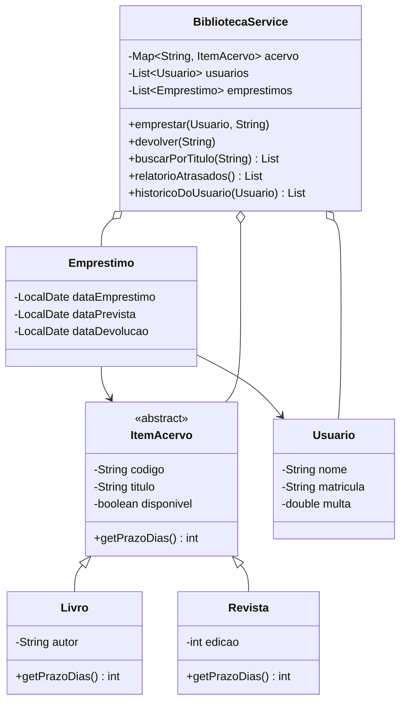

# Sistema de Biblioteca

Projeto em Java para a disciplina de Programação Orientada a Objetos.
O sistema controla o acervo de uma biblioteca, os usuários e os empréstimos.

## Como executar

1. Instale o Java 17 ou superior
2. Clone o repositório:
   ```
   git clone https://github.com/SEU-USUARIO/biblioteca.git
   cd biblioteca
   ```
3. Compile e rode:
   ```
   javac -d out src/*.java
   java -cp out Main
   ```

## Diagrama de classes



## Regras inovadoras

- Cada tipo de item tem um prazo diferente (livro: 14 dias, revista: 7 dias)
- Usuário com multa em aberto fica suspenso e não pode pegar novos itens
- A multa é de R$ 1,00 por dia de atraso
- Busca por parte do título, sem diferenciar maiúsculas de minúsculas
- Relatório de itens em atraso
- Histórico de empréstimos de cada usuário

## Autor

Seu Nome - Curso / Turma
